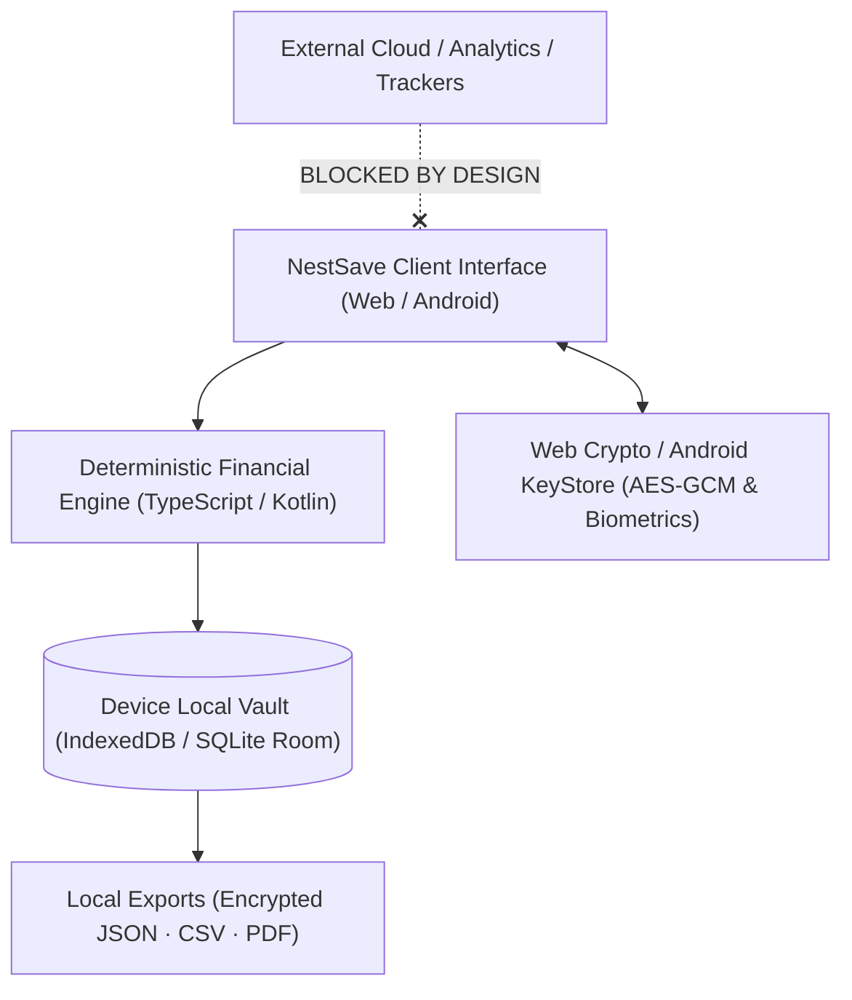

<div align="center">


# NestSave
### Private, 100% Offline-First Savings Goal Planner & Wealth Roadmap

NestSave plans, tracks, and protects your financial goals entirely on your personal device.  
**No accounts. No cloud databases. No bank sync. No tracking.**

<br />

<a href="https://nestsave.vercel.app/" target="_blank">
  
</a>
&nbsp;&nbsp;
<a href="https://nestsave.vercel.app/download" target="_blank">
  
</a>
&nbsp;&nbsp;
<a href="https://github.com/jojin1709/NestSave-Savings-Planner/releases/tag/v1.0.0" target="_blank">
  
</a>

<br /><br />

<p><strong>Access NestSave Anywhere</strong></p>

```bash
# Launch directly in your browser:
https://nestsave.vercel.app

# Download the standalone Native Android APK:
https://nestsave.vercel.app/download
```

<sub>Available as a Web App, offline PWA, and 100% native Android application (Kotlin + Jetpack Compose + SQLite Room).</sub>

---

</div>

> [!NOTE]
> **100% Private & Local-First:** Your financial numbers, transactions, salaries, and targets are never uploaded to any server. Everything is stored in your device's private sandbox (IndexedDB on Web, SQLite Room on Android).

> [!IMPORTANT]
> **Zero Fabricated Data Policy:** NestSave ships with a completely clean slate. There are no synthetic balances, fake transactions, or mock charts. Every calculation and milestone reflects your real data.

> [!TIP]
> **Native Android App (v1.0.0):** Download the standalone signed APK directly from [/download](https://nestsave.vercel.app/download) or [GitHub Releases](https://github.com/jojin1709/NestSave-Savings-Planner/releases/tag/v1.0.0) with hardware biometric unlock and zero internet permissions required.

---

## Table of Contents

- [What is NestSave?](#what-is-nestsave)
  - [Why NestSave Exists](#why-nestsave-exists)
  - [Why "NestSave"?](#why-nestsave)
  - [Not Another Cloud Data Harvester](#not-another-cloud-data-harvester)
- [Quick Start](#quick-start)
  - [Web & Desktop PWA](#web--desktop-pwa)
  - [Native Android App](#native-android-app)
- [Key Capabilities](#key-capabilities)
- [Banking & Financial Suite](#banking--financial-suite)
  - [Bank Recurring Deposit (RD) Calculator](#bank-recurring-deposit-rd-calculator)
  - [Bank Fixed Deposit (FD) Calculator](#bank-fixed-deposit-fd-calculator)
  - [SIP Compound Wealth Calculator](#sip-compound-wealth-calculator)
  - [Savings vs. EMI Loan Comparison](#savings-vs-emi-loan-comparison)
  - [Tiered Emergency Fund Safety Net](#tiered-emergency-fund-safety-net)
- [Intelligent Plan Recalibration & Real Value](#intelligent-plan-recalibration--real-value)
  - [1-Click Behind-Schedule Recalibration](#1-click-behind-schedule-recalibration)
  - [Inflation Adjustment Engine](#inflation-adjustment-engine)
- [Security, App Lock & Data Portability](#security-app-lock--data-portability)
- [Editions & Platform Support](#editions--platform-support)
- [Architecture](#architecture)
- [Tech Stack](#tech-stack)
- [Common Questions (FAQ)](#common-questions-faq)
- [Developer & License](#developer--license)

---

## What is NestSave?

**NestSave** is an autonomous, private financial roadmap and savings planner built for people who want absolute clarity over their wealth goals without giving away their private financial data.

Whether you are saving for a home down payment, higher education, a vehicle, an emergency fund, or building disciplined savings habits, NestSave calculates exactly what is required down to the day, week, and month. It determines whether your goal is **Doable**, **Tight**, or **Not Realistic** based on your verified monthly cash flow, tracks every deposit, and warns you the moment a plan falls behind schedule.

<a id="why-nestsave-exists"></a>
<details>
<summary><strong>Why NestSave Exists</strong></summary>

Most personal finance apps have become ad-laden data brokers: they demand bank login credentials, store transaction histories in unencrypted third-party clouds, and sell financial insights to credit card companies.

NestSave exists to restore the original promise of personal software: **pure, deterministic utility that runs exclusively on your hardware.** You do not need an account, an email address, or an internet connection to plan your financial independence.

</details>

<a id="why-nestsave"></a>
<details>
<summary><strong>Why "NestSave"?</strong></summary>

A nest is where you carefully construct something safe, resilient, and secure over time. NestSave is where you build your family's financial safety net — one goal, one deposit, and one milestone at a time.

</details>

<a id="not-another-cloud-data-harvester"></a>
<details>
<summary><strong>Not Another Cloud Data Harvester</strong></summary>

- **Zero Cloud Databases:** No Firebase, AWS RDS, Supabase, or external API endpoints.
- **Zero Third-Party Trackers:** No Google Analytics, Meta Pixel, or telemetry SDKs.
- **Zero Internet Permissions Required:** The native Android application operates with zero network socket permissions.
- **100% Cryptographic Security:** Vault exports use client-side AES-GCM 256-bit encryption derived via PBKDF2 with SHA-256 salts.

</details>

---

## Quick Start

### Web & Desktop PWA

Launch the web app directly in any modern browser:

```bash
https://nestsave.vercel.app
```

- **Offline Support:** Powered by a background Service Worker and IndexedDB vault.
- **Install as PWA:** Click **Install App** in Chrome, Edge, Safari, or Brave to run NestSave as a standalone desktop or mobile app.

### Native Android App

Download and install the native Android release APK directly on your phone or tablet:

```bash
https://nestsave.vercel.app/download
```

1. Download **`NestSave-v1.0.0.apk`** (~12.2 MB).
2. Tap the downloaded APK in your Android notification tray.
3. If prompted, toggle **Allow from this source**.
4. Tap **Install** and launch NestSave.

---

## Key Capabilities

- **Deterministic Financial Engine:** Pure TypeScript & Kotlin mathematical models calculate exact required contributions with zero floating-point drift or hallucination.
- **Multi-Goal Conflict Detection:** Identifies when multiple goals compete for the same monthly cash surplus and calculates priority-weighted distribution.
- **Milestone Celebrations:** Persistent celebration checkpoints at 25%, 50%, 75%, and 100% goal completion with canvas confetti and haptic feedback.
- **Salary Day 1-Tap Batch Allocator:** Distributes and logs scheduled monthly contributions across all active goals simultaneously on payday with a single confirmation.
- **Savings Streak & Badges:** Gamified habit tracking with deposit streaks, milestone achievement badges, and disciplined savings momentum.
- **Expense & Budget Tracker:** Monthly category spending caps with live percentage indicators and overspending warnings.
- **Password-Encrypted Vault Backup:** Export full encrypted database snapshots using **AES-GCM 256** encryption protected by a master password.
- **Printable Statements & Completion Certificates:** Generates clean, printer-ready 1-page financial summaries and achievement certificates directly on-device.

---

## Banking & Financial Suite

NestSave includes specialized financial calculators tailored specifically for Indian banking standards and wealth accumulation:

| Tool | Methodology | Purpose |
| :--- | :--- | :--- |
| **Bank RD Calculator** | Indian quarterly compounding: $A = P \times \frac{(1 + r/4)^{4n} - 1}{1 - (1 + r/4)^{-1/3}}$ | Calculates Recurring Deposit maturity corpus, interest earned, and converts to a goal in 1-click. |
| **Bank FD Calculator** | Quarterly compounding standard: $A = P \times (1 + r/4)^{4n}$ | Simulates Fixed Deposit returns, total wealth gain, and annualized yield. |
| **SIP Wealth Engine** | Monthly compound compounding: $A = P \times \frac{(1 + i)^n - 1}{i} \times (1 + i)$ | Models long-term mutual fund wealth creation, invested capital vs. returns. |
| **Savings vs. EMI** | Reducing balance loan amortisation vs. cash savings rate | Calculates exact interest and fee penalties paid on loans vs. interest saved by buying in cash. |
| **Emergency Buffer** | 3-Tiered safety net (3-Month Essential, 6-Month Standard, 12-Month Fortress) | Determines non-negotiable living expenses and builds an emergency cash cushion. |

---

## Intelligent Plan Recalibration & Real Value

### 1-Click Behind-Schedule Recalibration

When real-world expenses cause a goal to fall behind its target trajectory, NestSave warns you and offers instant 1-click recalibration:

1. **Option A — Keep Deadline:** Recalculates the exact increased monthly contribution required to hit the original completion date.
2. **Option B — Keep Savings Pace:** Extends the deadline forward to a realistic date based on your actual historical savings speed.

### Inflation Adjustment Engine

For goals 3 to 10 years in the future (higher education, car, house down payment), ₹1,00,000 today will not buy the same asset tomorrow. NestSave includes an inflation adjustment engine ($FV = PV \times (1 + r)^n$) directly inside the Goal Creation Wizard to calculate future required corpus based on realistic inflation (e.g. 6% p.a.).

---

## Security, App Lock & Data Portability

```
┌────────────────────────────────────────────────────────┐
│                   NestSave Security                    │
├──────────────────────────┬─────────────────────────────┤
│ 4-Digit Local PIN Lock   │ SHA-256 + Cryptographic Salt│
│ Password-Encrypted Vault │ AES-GCM 256-bit + PBKDF2    │
│ Android Biometrics       │ Fingerprint / Face Unlock   │
│ Network Telemetry        │ ZERO (0 bytes transmitted)  │
│ Portability Formats      │ Encrypted JSON, CSV, PDF    │
└──────────────────────────┴─────────────────────────────┘
```

---

## Editions & Platform Support

| Feature | Web Application | Offline PWA | Native Android App |
| :--- | :---: | :---: | :---: |
| **Platform** | Any Browser | iOS, macOS, Windows | Android 8.0+ (API 26–35) |
| **Storage Engine** | IndexedDB | IndexedDB | SQLite Room Database |
| **Offline First** | Yes (cached) | 100% Offline | 100% Offline |
| **Biometric Lock** | PIN Lock | PIN Lock | Hardware Biometrics |
| **Network Access** | Vercel CDN only | Zero runtime net | Zero network permission |
| **Download Link** | [Open Web App](https://nestsave.vercel.app) | Browser Menu → Install | [Download APK](https://nestsave.vercel.app/download) |

---

## Architecture

NestSave is architected around strict local-first and zero-cloud separation:



1. **Client Interface:** Responsive Pitch-Black dark mode UI built with Next.js 14 and Jetpack Compose.
2. **Deterministic Engine:** Math models execute locally with zero network calls.
3. **Local Vault:** All state is persisted to IndexedDB or Android SQLite Room.
4. **Encrypted Portability:** AES-GCM 256 encrypted snapshots allow seamless backups between devices.

---

## Tech Stack

- **Web Frontend:** Next.js 14 (App Router), React 18, TypeScript, Tailwind CSS v3, Lucide React.
- **Android Native:** Kotlin, Jetpack Compose, Material 3, AndroidX Room SQLite, Biometric API.
- **Security & Crypto:** Web Crypto API (SubtleCrypto), PBKDF2, SHA-256, AES-GCM.
- **Deployment:** Vercel (Edge CDN for static assets).

---

## Common Questions (FAQ)

### Can I use NestSave completely offline?
Yes. On both web (as a PWA) and the native Android app, NestSave functions without an internet connection.

### Does NestSave connect to my bank account?
No. NestSave will never ask for your bank credentials, net banking passwords, or card numbers. You retain complete privacy.

### Where is my data stored?
Your data never leaves your device. On web browsers, data is stored in the browser's sandboxed IndexedDB storage. On Android, it is stored in an encrypted SQLite Room database.

### How do I transfer data between devices?
Go to **Settings → Encrypted Vault Backup**, set a secure password, and export your `.json` file. On your new device, select **Restore Encrypted Vault** and enter your password.

---

## Developer & License

**Built with pride by [Jojin John](https://github.com/jojin1709)**  
NestSave is an independent software project crafted with care as a private, high-integrity alternative to commercial data-harvesting finance platforms.

Copyright © 2026 **Jojin John**. All rights reserved.

<div align="center">

<br />

**[Launch NestSave Web App](https://nestsave.vercel.app)** • **[Download Android APK](https://nestsave.vercel.app/download)** • **[GitHub Releases](https://github.com/jojin1709/NestSave-Savings-Planner/releases)**

*Your savings. Your device. Your rules.*

</div>
